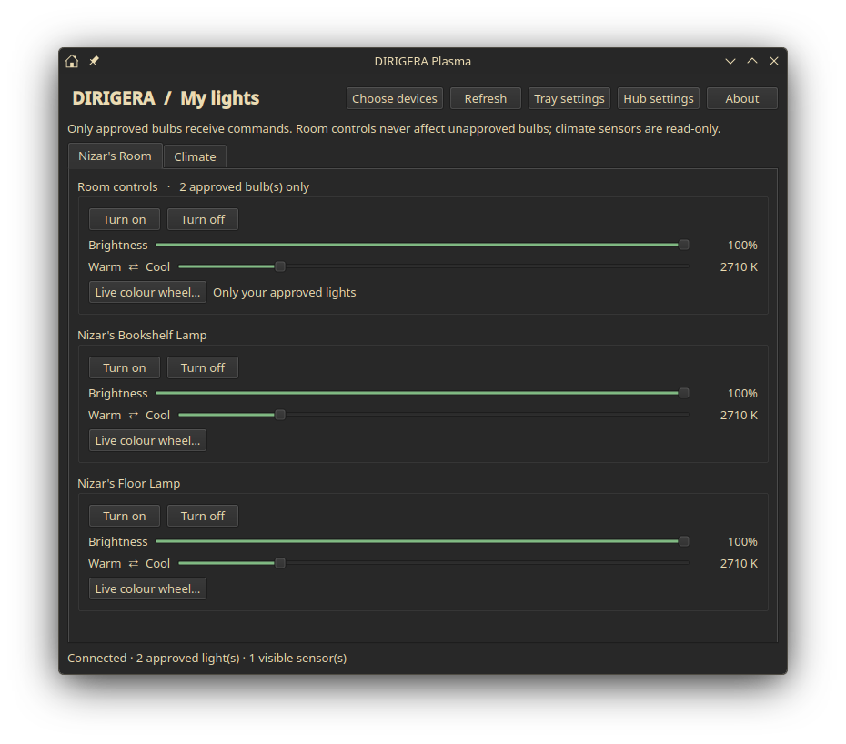
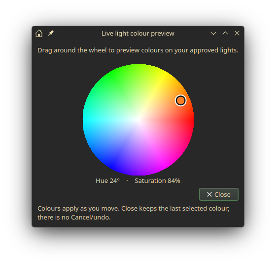
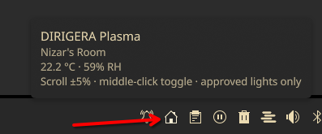
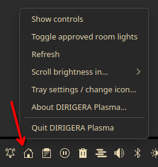
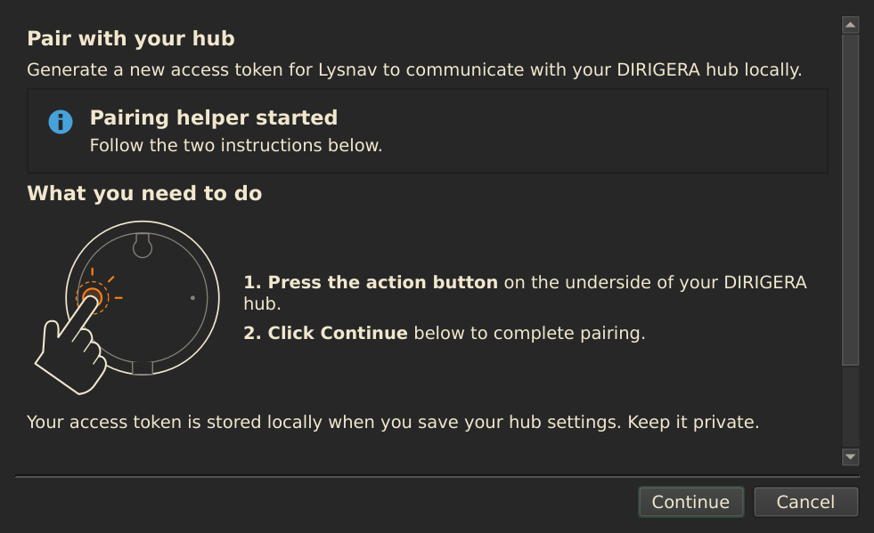
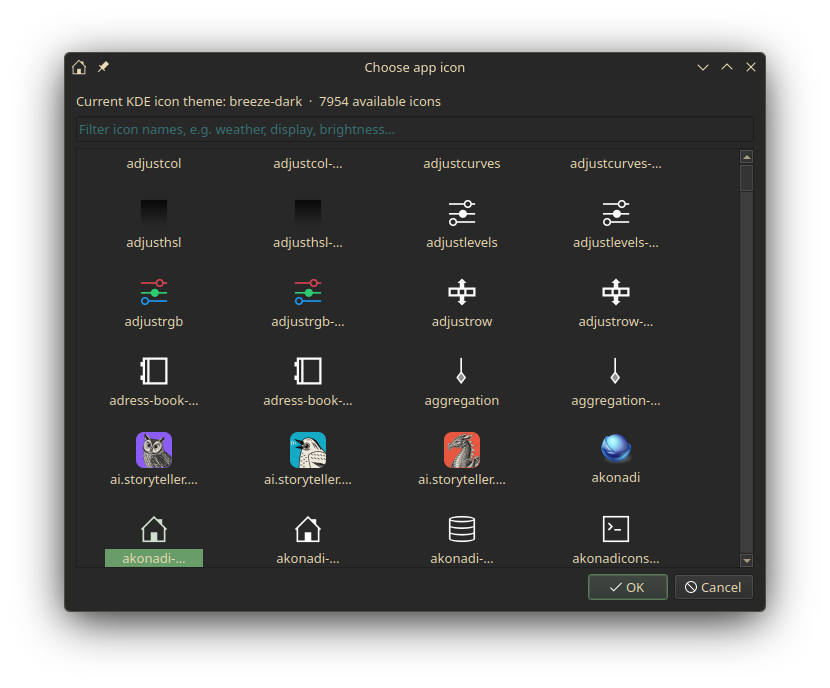
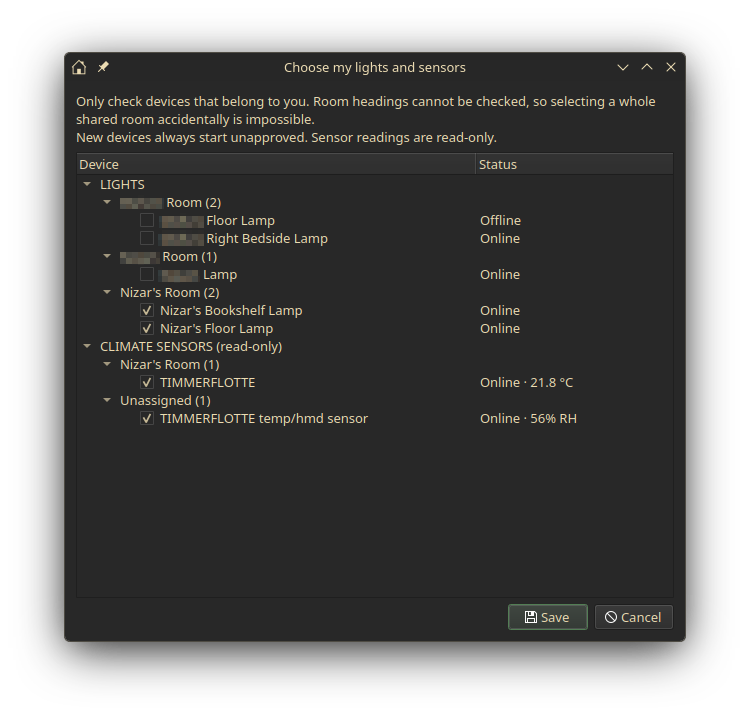

# DIRIGERA Plasma

**Your IKEA DIRIGERA smart home hub, seamlessly integrated with KDE Plasma.**

Control your lights from the desktop or system tray, see room temperature and humidity at a glance, and keep everything local. No Home Assistant server, additional hub, or IKEA cloud login is needed **to operate this app**.

[](LICENSE)
[](#requirements)

> **v1.0.0 is available as a Linux x86_64 AppImage.** Tested with KDE Plasma on Bazzite, including a clean graphical pairing flow and local lighting/tray controls. The Flatpak is still undergoing runtime testing and is **not yet a published release asset**.

<p align="center">
  
</p>

<p align="center"><sub>Room-wide and individual light controls, styled by KDE Plasma.</sub></p>

## Why DIRIGERA Plasma?

Your smart lights shouldn't require unlocking your phone every time you want to dim them. DIRIGERA Plasma brings lighting controls to the desktop you're already using. It communicates **directly with the IKEA DIRIGERA hub on your local network**, leaving the hub to manage its connected lights and sensors.

- **Local and private:** No cloud account, login, telemetry, or remote automation server is required by DIRIGERA Plasma. After installation, normal operation works without internet access, provided the PC and hub can communicate over your LAN.
- **Control without opening a window:** Scroll over the Plasma tray icon to dim or brighten; middle-click to toggle the lights in your selected room. The tray's native right-click menu gives quick access to the app.
- **GUI-first hub authorization:** Generate the hub access token inside the app. No copying commands or tokens from a terminal during setup.
- **Built for shared homes:** Approve only the bulbs you want the app to control. Other residents' bulbs remain outside its lighting controls.
- **Climate at a glance:** Hover over the tray icon to see approved temperature and humidity readings, or open the Climate tab for more information.
- **Feels at home in Plasma:** Built with Qt for Python (PySide6), with native Plasma tray integration and an icon picker based on your **active KDE icon theme**, not a bundled icon pack.

## See it in action

The app provides per-device and per-room power, brightness, colour temperature, and a **live colour wheel** for bulbs that support colour changes. Changes to the colour wheel are previewed on the lights as you move it.

### Live colour control

Move the colour wheel to preview changes immediately on your approved RGB lights, without closing the picker after every adjustment.

<p align="center">
  
</p>

### At a glance, without opening a window

A hover reveals room climate readings. Scroll over the tray icon to change brightness, middle-click to toggle your approved room lights, or right-click for native Plasma actions.

| Climate readings on hover | Native Plasma tray menu |
| :---: | :---: |
|  |  |

## Requirements

- **Linux with KDE Plasma** (Plasma 6 is the primary development target; currently tested on Bazzite/KDE Plasma).
- An **IKEA DIRIGERA smart home hub**, already configured with supported lights and/or climate sensors through IKEA Home Smart.
- The PC and hub on a **mutually reachable local network**.
- For **source installation only**: Python 3.11+, virtual environment support (`python3 -m venv`), and internet access to download Python dependencies once. The AppImage bundles its dependencies.

**No additional Matter controller, Thread dongle, or Home Assistant installation is required.** Your existing DIRIGERA hub continues managing its devices. This app talks to the hub's unofficial local API; it does not re-pair your bulbs or administer the Thread network itself.

## Install

### AppImage (recommended for v1.0.0)

Download `DIRIGERA-Plasma-v1.0.0-x86_64.AppImage` from the [latest GitHub release](https://github.com/alsiniz/dirigera-plasma/releases/latest). This portable package needs no root privileges, separate smart-home hub, or Python setup.

```bash
chmod +x DIRIGERA-Plasma-v1.0.0-x86_64.AppImage
./DIRIGERA-Plasma-v1.0.0-x86_64.AppImage
```

For convenience you may integrate the AppImage into your application launcher using a tool that supports AppImages; direct execution remains supported. An optional **nonfatal portal app-ID warning** may appear when starting directly from a download folder because the portable app is not registered as an installed desktop application.

**Platform:** Linux x86_64 with KDE Plasma. Bazzite/KDE Plasma has been verified. Other Linux distributions may work but have not yet been individually tested.

### Source installation (alternative)

```bash
git clone https://github.com/alsiniz/dirigera-plasma.git
cd dirigera-plasma
./install.sh
```

Alternatively, select **Code → Download ZIP** on GitHub, extract it, then run `bash install.sh` from the extracted directory.

The installer creates an isolated Python environment under `~/.local/share/dirigera-plasma/` and adds **DIRIGERA Plasma** to your KDE application launcher. It does not need `sudo`, and it does not start a separate server or system service. Its first run downloads the required Python packages.

> **Other Linux distributions:** The source installer may work on other Plasma distributions, but these have not yet been validated. If virtual environments are unavailable, install your distribution's Python venv package first.

### Connect your hub through the GUI

Once installed, launch **DIRIGERA Plasma** from KDE's application launcher:

1. In **Hub settings**, enter your DIRIGERA hub's local IP address or a supported local hostname. You can usually find its IP in your router's connected-device list.
2. The **Generate token** button becomes available when the address has a valid format. Click it to open the pairing dialog.
3. **Press the physical action button underneath your DIRIGERA hub** when instructed. Return to the app and click **Continue**.
4. The new access token is entered into the **masked Access token field automatically**. Click **Save** to keep it. You don't need to copy or paste the token.
5. Open **Choose devices** and explicitly approve the lights and climate sensors you want to use.

The app is **authorizing access to your existing hub**, not pairing the light bulbs a second time. The phone app is still needed for initial IKEA hub/device setup. You can cancel the token dialog without replacing your previously saved access token.

**Tip:** Reserve a consistent IP address for DIRIGERA in your router's DHCP settings so the hub remains reachable at the saved address. Router instructions vary by manufacturer.

<p align="center">
  
</p>

> **Verified:** The AppImage's GUI pairing process succeeded from a clean configuration on Bazzite. Flatpak pairing remains untested.

## Control from the Plasma tray

| Interaction | What happens |
| --- | --- |
| **Hover** | View temperature and humidity from your approved climate sensors. |
| **Scroll up or down** | Adjust brightness of approved, currently-on bulbs in the selected room, in 5% steps. Off bulbs remain off. |
| **Middle-click** | Toggle approved room lights together. |
| **Left-click** | Open the full controls window. |
| **Right-click** | Open the native Plasma menu for quick actions, settings, and Quit. |

Brightness scrolling shows a brief on-screen percentage and combines rapid wheel input before sending the command. Under **Tray settings**, choose the room controlled by tray actions and the **App icon** used by the panel and application window. Icons are resolved from your **current KDE icon theme** and its inherited themes; icon artwork is not bundled.

For finer control, open the window to change individual bulbs or approved bulbs within a room. The **Climate** tab provides read-only sensor information, including combined temperature and humidity data from supported split-endpoint devices such as IKEA TIMMERFLOTTE.

### Match your Plasma theme

Choose an app icon from the icon theme already installed and selected in KDE Plasma. No Breeze icons or separate icon packs are bundled with DIRIGERA Plasma.

<p align="center">
  
</p>

## Shared households and privacy

**Only explicitly approved bulbs receive commands from DIRIGERA Plasma.** Device approvals are tied to device IDs, not simply names. Room controls are restricted to approved lights, and if a bulb moves to another room, it must be reviewed and approved again. New devices are not approved automatically.

<p align="center">
  
</p>

**Important:** These restrictions apply to **this app**, not to the hub's access token. That token can potentially control *all* devices on the shared DIRIGERA hub. Someone who obtains it could use other software to control other residents' devices. Keep it private, just as you would a password.

- App settings are stored in `~/.config/dirigera-plasma/config.json`, readable only by your local user account under the standard installation. The access token is stored there; protect backups of this file.
- No cloud connection or external account is required for day-to-day control. Opening the optional Ko-fi link uses your browser, by choice.
- The app uses the **unofficial, undocumented local DIRIGERA API**. IKEA firmware updates could affect compatibility.

## Package availability

| Format | v1.0.0 availability | Status |
| --- | --- | --- |
| **AppImage (x86_64)** | [GitHub Releases](https://github.com/alsiniz/dirigera-plasma/releases/latest) | Tested on Bazzite / KDE Plasma, including clean in-app pairing |
| **Source installer** | This repository | Available; requires a one-time Python dependency download |
| **Flatpak** | Not published | Builds in GitHub Actions, but actual KDE Plasma runtime behavior and pairing still need validation |

AppImage can run without installation, whereas Flatpak uses application ID `io.github.alsiniz.DirigeraPlasma` and has its own sandboxed configuration. When Flatpak becomes available, it will need separate GUI hub authorization on first launch.

## Troubleshooting

| Symptom | Try this |
| --- | --- |
| Hub won't connect | Check the saved address, same-LAN reachability, and router DHCP reservation. |
| A bulb isn't controllable | Check **Choose devices**; newly added or moved bulbs need approval. |
| Colour controls are unavailable | Not every bulb supports RGB colour or colour temperature adjustments. |
| Tray scroll or right-click doesn't work | Open **Tray settings → Input diagnostics** in the main window and file a redacted bug report. |
| No climate reading | Approve the relevant sensor in **Choose devices**. |

Closing the main window keeps the app available in the system tray. To exit completely, choose **Quit** from the native tray menu or press **Ctrl+Q** while the main window is focused.

More technical details are available in [TESTING.md](TESTING.md), [SECURITY.md](SECURITY.md), and [CONTRIBUTING.md](CONTRIBUTING.md). Please **never post your access token or configuration file** in a GitHub issue.

## Roadmap

- **Flatpak:** validate hub pairing, desktop permissions, climate tooltip, native menu, tray wheel, and middle-click on KDE Plasma; then add the verified bundle to a future release.
- **Wider Linux compatibility:** run AppImage smoke tests on additional KDE Plasma distributions and document limitations.
- **Desktop integration:** provide optional AppImage launcher registration for a cleaner portal identity.
- **Maintenance:** monitor IKEA DIRIGERA firmware changes affecting its unofficial local API.

See [CHANGELOG.md](CHANGELOG.md) for the v1.0.0 release history and ongoing fixes.

## Built with and thanks

- [dirigera](https://github.com/Leggin/dirigera) by Leggin and contributors, for the unofficial DIRIGERA local API client.
- [Qt for Python / PySide6](https://doc.qt.io/qtforpython-6/) for the native Qt interface.
- [dbus-next](https://github.com/altdesktop/python-dbus-next) for Plasma StatusNotifierItem and D-BusMenu integration.
- [KDE Plasma](https://kde.org/plasma-desktop/) and the active icon theme installed on the user's system.

**Created and maintained by [alsiniz](https://github.com/alsiniz)**, with development assistance from OpenAI ChatGPT. This is an independent community project, **not affiliated with or endorsed by IKEA or KDE**. See [third-party notices](THIRD_PARTY_NOTICES.md).

**License:** [MIT](LICENSE). Free to use, modify, redistribute, and use commercially under its terms.

If this project makes your desktop a little more convenient, [support its development on Ko-fi](https://ko-fi.com/alsiniz).
